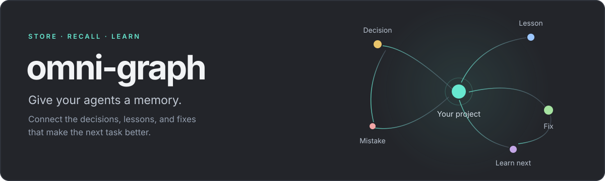

<div align="center">



**Local memory for your AI agents. A graph you can explore.**

[](LICENSE)


[Install](#install) · [Get started](#get-started) · [Agent setup](#agent-setup) · [Explore the graph](#explore-the-graph) · [Contribute](CONTRIBUTING.md)

</div>

Omni-graph keeps the context that should survive an agent session: why you made a decision, what went wrong, how you fixed it, and what to learn next. Memories connect across a graph, so your agents can retrieve the surrounding context instead of starting over.

Use it across freelance work, client projects, and personal repositories. Keep shared preferences global and project knowledge close to the work.

- **Remember with context.** Store decisions, constraints, lessons, mistakes, fixes, learning goals, and handoffs.
- **Retrieve before acting.** Search with SQLite FTS5 and recall related memories through graph connections.
- **Learn from the last attempt.** Connect failures to fixes, lessons, and verification evidence.
- **See the relationships.** Explore a browser or Rust terminal graph with search, pan, zoom, draggable nodes, and animated connections.
- **Keep control of your data.** Local SQLite storage, explicit sharing, and no database server or account required.

## Install

Both installers download the compiled package from [GitHub Releases](https://github.com/Rekabytes-Enterprise/omni-graph/releases). No npm registry publication or account is required.

### With npx

Requires Node.js 20 or newer for installation:

```sh
npx --yes --package=https://github.com/Rekabytes-Enterprise/omni-graph/releases/latest/download/omni-graph.tgz omni-graph install
```

The GitHub release contains a ready-to-run npm tarball with native executables. This installs a standalone native executable in `~/.omni-graph/bin` and initializes your memory home. Node.js is not needed to run the installed executable.

### With curl

On macOS or Linux, install the native release directly:

```sh
curl -fsSL https://github.com/Rekabytes-Enterprise/omni-graph/releases/latest/download/install.sh | sh
```

The installer verifies the archive against the release's SHA-256 checksums before running it. No Node.js, Rust toolchain, or administrator access is required.

### Make the command available

On macOS and Linux, the installer automatically creates `~/.omni-graph/` and saves a managed PATH entry in your shell configuration. Bash uses `.bashrc` and your active login profile; zsh uses `.zshrc` and `.zprofile` (including an absolute `ZDOTDIR`); fish uses its `conf.d` directory. Existing shell configuration is preserved, and reinstalls update the same entry.

**For the terminal you installed from, run the activation command printed by the installer first.** With the default location on Bash or zsh:

```sh
export PATH="$HOME/.omni-graph/bin:$PATH"
```

Then change to your project's directory and run `omni-graph init`. Future terminals load the saved PATH automatically. A child installer cannot change its parent terminal's environment. If you set `OMNI_GRAPH_HOME` to a custom location, use the exact activation command from the installer.

You can also run the executable directly, without changing PATH:

```sh
"$HOME/.omni-graph/bin/omni-graph" init
```

On Windows, add `%USERPROFILE%\.omni-graph\bin` to your user `Path` and open a new terminal. If shell configuration could not be updated, the installer reports a warning and prints the manual activation command.

**Platforms:** macOS Apple Silicon and Intel; Linux x64 and arm64 with glibc; Windows x64 through npx. Linux release builds require glibc 2.35+ on x64 and 2.39+ on arm64. The curl installer requires `curl`, `tar`, and `sha256sum` or `shasum`. Alpine/musl is not currently a release target.

<details>
<summary>Run without a persistent installation</summary>

Use the release tarball with npx:

```sh
npx --yes --package=https://github.com/Rekabytes-Enterprise/omni-graph/releases/latest/download/omni-graph.tgz omni-graph init
npx --yes --package=https://github.com/Rekabytes-Enterprise/omni-graph/releases/latest/download/omni-graph.tgz omni-graph
```

Your memories still persist in your user memory home and project folder. The short registry command `npx omni-graph@latest` is not available until the package is separately published to npm; use the GitHub URL above.

</details>

## Get started

Run these commands from your project's root:

```sh
omni-graph init --name "My project"
omni-graph
```

Initialization creates the project's `.omni-graph/` folder, registers the project, and installs agent skills and instructions. It starts with an empty memory graph. Run `init` again to refresh integrations without resetting your memories.

Save something worth remembering:

```sh
omni-graph remember \
  --type lesson \
  --title "Check every consumer before changing shared props" \
  --body "Find the affected callers and verify each one when changing a shared component contract." \
  --trigger "Changing a shared component or exported interface"
```

Recall relevant context before the next task:

```sh
omni-graph recall "changing a shared component" --json
```

You can run commands from any directory inside an initialized project. To work with another project, use `omni-graph --directory /path/to/project` followed by the command.

## Agent setup

`omni-graph init` installs the bundled memory skill and adds a clearly marked instruction block to supported agent files. Existing instructions outside that block are preserved.

| Agent | Skill | Instructions |
| --- | --- | --- |
| Codex | `.agents/skills/omni-graph/SKILL.md` | `AGENTS.md` |
| Claude Code | `.claude/skills/omni-graph/SKILL.md` | `CLAUDE.md` |
| Pi | `.agents/skills/omni-graph/SKILL.md` | `AGENTS.md` |

Choose integrations during initialization, or refresh them later:

```sh
omni-graph init --agent codex,claude
omni-graph setup --agent pi
```

Use `--agent none` to initialize without writing agent integrations. Restart the agent session or reload skills if it does not discover a newly installed skill.

For other agents, the JSON CLI is available directly. A useful instruction is:

> Before meaningful work, recall relevant Omni-graph memories. After a verified fix, useful discovery, or user correction, save the durable lesson with its context and evidence. Keep knowledge in the appropriate scope.

Skills guide agent behavior; the agent must follow them. Omni-graph does not run a language model or automatically turn every conversation into memory.

## Memory that belongs in the right place

| Scope | What belongs here | Where it lives |
| --- | --- | --- |
| **Global** | Your preferences and broadly reusable knowledge | `~/.omni-graph/memory.sqlite` |
| **Client** | Context shared across one client's projects | `~/.omni-graph/clients/CLIENT_ID/memory.sqlite` |
| **Project** | Architecture, decisions, constraints, lessons, and fixes | `PROJECT/.omni-graph/memory.sqlite` |
| **Task** | Focused progress, investigation, or a handoff with a task ID | The project's database |

Project scope is the default. Client memories are available only to projects associated with that client. Task memories carry a task ID so agents can retrieve the relevant work.

Create a client and associate a project using the ID returned by the first command:

```sh
omni-graph client add "Your client" --json
omni-graph init --name "Client project" --client CLIENT_ID
```

Replace `CLIENT_ID` with the returned ID. Associate the client when initializing a new project; rerunning initialization does not change project ownership.

### Learn from mistakes

A useful memory explains when it matters and what to do next. Record the failure, cause, prevention, evidence, and verification instead of saving an unstructured transcript.

Connect records with relationships such as:

```text
mistake ──corrected_by──▶ fix
   └──────teaches───────▶ lesson
learning_goal ──resolved_by──▶ finding
```

Use `omni-graph remember --file memory.json` for structured records, and `omni-graph link MEMORY_ID corrected_by FIX_ID` to connect their returned IDs. Run `omni-graph review --json` to find open work, recurring mistakes, and memories due for review. Mark a fix verified only after recording verification evidence.

## Explore the graph

Run `omni-graph` inside an initialized project, then choose **Web UI**, **TUI**, or **Remote** with the arrow keys and Enter (or press `1` / `2` / `3`).

**Web UI** starts a local server and opens your browser at **http://127.0.0.1:52716**. Explore a true 3D graph with sphere nodes, curved connections, search, scope/type filters and memory details. Drag the background to orbit through 360° and tilt the view. Right-drag or Shift-drag to pan, scroll to zoom, or drag individual spheres to arrange them. On touchscreens, use one finger to orbit and two fingers to pan/zoom. Highly connected nodes have larger solid centers. Memory types have distinct colors and icons: issues are rose, mistakes coral, fixes mint, lessons amber and decisions violet. Click a type in the legend to filter the graph. Select a node to animate its connections; use **Pause flow** to stop animation. Agent changes refresh automatically every four seconds. Layout changes are temporary; memories are managed through the CLI.

```sh
omni-graph web                  # Open the browser graph directly
omni-graph web --no-open        # Print the URL without launching a browser
omni-graph web --port 52717     # Use another port if 52716 is busy
omni-graph tui                  # Open the terminal graph directly
```

**Using a headless server?** Generate a temporary HTTPS link with email/PIN sign-in:

```sh
omni-graph web --remote --email you@example.com
```

Replace `you@example.com` with your own email. Open the generated `https://….trycloudflare.com` link in your own device's browser, enter that email and request a PIN, then enter the PIN from your inbox. Ubuntu does not need a browser. Keep your PIN private; Omni-graph never asks for it in the terminal.

The startup menu also offers **Remote** and prompts for an email. To allow additional people, repeat `--email` or provide a comma-separated list. Exact email addresses are required; wildcard domains are rejected.

On first use, Omni-graph downloads and verifies a pinned `cloudflared` helper into `~/.omni-graph/tools/cloudflared/`. No administrator access, Cloudflare account or domain is required. The helper uses an isolated configuration and does not change your existing Cloudflare setup. Remote traffic passes through Cloudflare; its email sign-in protects the tunnel before requests reach the memory API. Remote access is opt-in and prints the link without opening a browser on the server.

Press **Ctrl+C** to stop the server and revoke the tunnel. Each session gets a new URL. These [Cloudflare Quick Tunnels](https://developers.cloudflare.com/tunnel/get-started/quick-tunnels/) are temporary and have no uptime guarantee. For access over an existing SSH connection without a tunnel provider, run `omni-graph web --no-open` and forward local port 52716 to the server's `127.0.0.1:52716` in Termius.

The server listens on this machine only. Keep the terminal running while using the Web UI; press **Ctrl+C** to stop it. Both views use the same existing SQLite memories and scope boundaries. No frontend setup or internet connection is required. The 3D view needs a browser with WebGL2 enabled.

**TUI controls**

- **Click** a node to inspect its memory. More connected nodes have larger solid centers.
- **Scroll** to zoom around the pointer. **Drag the background** to pan, or drag a node to move it.
- Connections around the selected node have repeating, staggered pulses. Press **`p`** to pause or resume.
- Layout changes and memory selection use subtle animations. Terminal fonts and character resolution affect their appearance.

| Key | Action |
| --- | --- |
| `/` | Search memories |
| `j` / `k` | Select a memory |
| Arrow keys | Pan the graph; `g` switches graph/list keyboard focus |
| `+` / `-` | Zoom |
| `0` / `f` | Fit the graph / center the selected node |
| `z` | Expand or restore the graph view |
| Tab / Enter | Select a connection / follow it |
| Backspace | Return to the previous node |
| `p` | Pause or resume connection flow |
| `R` / `r` | Smoothly restore the layout / reload memories |
| `s` / `a` | Cycle scope / include inactive history |
| `m` | Toggle mouse capture for terminal text selection |
| `q` | Quit |

Use a terminal of at least 75 columns by 16 rows. Mouse-pointer changes require terminal support; keyboard navigation remains available.

## Your data, locally

```text
~/.omni-graph/
├── bin/omni-graph          # Installed executable (.exe on Windows)
├── memory.sqlite          # Global memory
├── registry.json          # Registered clients and projects
└── clients/
    └── CLIENT_ID/memory.sqlite

YOUR_PROJECT/
└── .omni-graph/
    ├── project.json        # Stable project identity
    ├── memory.sqlite      # Project and task memory
    └── .gitignore          # Excludes local memory databases and sidecars
```

Set `OMNI_GRAPH_HOME` to use a different memory home; persistent installs put the executable in that home's `bin` directory too. Agent skills remain in each project's agent directories.

Memory commands work locally. Omni-graph uses SQLite FTS5 plus graph traversal for retrieval; it does not require PostgreSQL, a vector database, or an embedding service. Omni-graph does not encrypt its databases.

Project database files are ignored by the generated `.omni-graph/.gitignore`. Project identity and agent instructions can be versioned. Export includes only project/task memories explicitly marked `project_shared`:

```sh
omni-graph export --output shared-memory.json
omni-graph import --file shared-memory.json
```

Import requires the same stable project identity. Private, client, and global memories are excluded from shared exports. Marking a memory shared does not upload or synchronize it.

For backups, stop running Omni-graph processes and copy your user memory home and each project's `.omni-graph` directory.

## Updates and help

Run `omni-graph update` from any directory to update the installed application from GitHub Releases. It verifies the release checksum and executable version before replacing the binary, and preserves memories, project registrations and agent skills. Close other running Omni-graph instances before updating.

```sh
omni-graph update
```

Application updates require **v0.2.1 or later**. If you have an older version, rerun the curl or GitHub-hosted npx installation command once to upgrade. There is no need to run `init` again for an existing project.

To edit a memory instead, supply both its ID and a JSON patch: `omni-graph update MEMORY_ID --file patch.json`. Supplying just one argument is rejected; it never starts an application update.

```sh
omni-graph --version
omni-graph --help
omni-graph doctor --json
```

`doctor` runs inside an initialized project. Use `omni-graph COMMAND --help` for individual commands. To pin a curl installation to a published version:

```sh
curl -fsSL https://github.com/Rekabytes-Enterprise/omni-graph/releases/download/v0.1.1/install.sh \
  | OMNI_GRAPH_VERSION=v0.1.1 sh
```

To uninstall the native command, remove the executable from `~/.omni-graph/bin` and remove its PATH entry from your shell profile. Your memories remain available for backup or a later installation.

## Contributing

Read [CONTRIBUTING.md](CONTRIBUTING.md) before starting. Create your branch from **`dev`** and open your pull request against **`dev`**. The `main` branch is maintained for stable releases.

## License

[MIT](LICENSE) © 2026 Omni-graph contributors.
